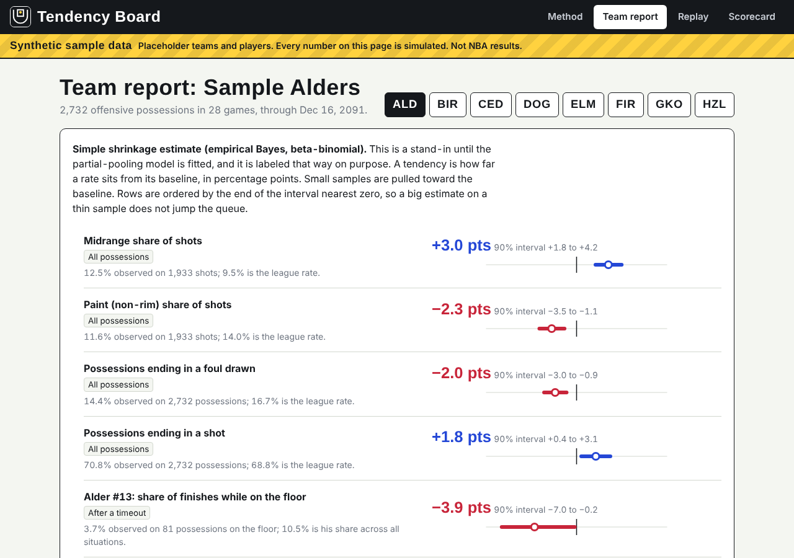

# Tendency Board

[](https://github.com/lightningjw/nba-tendency-board/actions/workflows/ci.yml)

Tendency Board predicts five things about the next NBA possession from public play-by-play: who finishes it,
how it ends, where the shot comes from, what kind of shot it is, and how early in the possession it comes. Each
prediction is scored against a simple baseline on games the model never saw, and the result is shown with its uncertainty whether it flatters the model or not. A tendency
layer turns the same possessions into scouting-style deviations ("more corner threes after timeouts than this
team's other possessions predict"), each with an interval and a sample size. A static web app sits on top: a
scorecard, team tendency reports (offense with a short written summary, a defense proxy, and what the bench
did at stoppages), a hot-hand report, and a possession-by-possession replay.

**Live app:** https://nba-tendency-board-app.vercel.app/ (simulated games with placeholder teams; real results
are in the table below, and [docs/terms-check.md](docs/terms-check.md) explains why real play-by-play is not
published).



## Results on real games

Three regular seasons, 2023-24 to 2025-26: 3,690 games, 738,812 possessions. Models trained on 1,968 games from
the first two seasons. Log-loss, lower is better; intervals are 95% from a bootstrap over whole games.

| Prediction | Held out | Possessions | Model | Baseline | Difference (95% interval) | Top pick right, model vs baseline |
|---|---|---|---|---|---|---|
| Who finishes | late 2024-25, 492 games | 96,302 | 1.5675 | 1.5716 | -0.0041 (-0.0046 to -0.0035) | 28.9% vs 28.7% |
| Who finishes | 2025-26, 1,230 games | 242,648 | 1.5668 | 1.5711 | -0.0043 (-0.0047 to -0.0040) | 29.0% vs 28.7% |
| How it ends | late 2024-25, 492 games | 97,103 | 0.6860 | 0.6970 | -0.0111 (-0.0121 to -0.0099) | 77.1% vs 76.8% |
| How it ends | 2025-26, 1,230 games | 244,406 | 0.7078 | 0.7194 | -0.0117 (-0.0124 to -0.0110) | 75.9% vs 75.6% |
| Where the shot comes from | late 2024-25, 492 games | 74,571 | 1.4782 | 1.5010 | -0.0228 (-0.0246 to -0.0211) | 34.6% vs 31.6% |
| Where the shot comes from | 2025-26, 1,230 games | 184,811 | 1.4801 | 1.4999 | -0.0197 (-0.0208 to -0.0187) | 34.9% vs 32.4% |
| What kind of shot it is (transformer) | late 2024-25, 492 games | 74,571 | 1.9807 | 1.9977 | -0.0170 (-0.0187 to -0.0154) | 29.9% vs 29.2% |
| What kind of shot it is (transformer) | 2025-26, 1,230 games | 184,811 | 1.9727 | 1.9878 | -0.0151 (-0.0162 to -0.0140) | 30.2% vs 29.7% |
| How early the first action comes | late 2024-25, 492 games | 94,836 | 0.9119 | 0.9439 | -0.0320 (-0.0339 to -0.0302) | 53.3% vs 50.8% |
| How early the first action comes | 2025-26, 1,230 games | 238,739 | 0.9159 | 0.9449 | -0.0290 (-0.0302 to -0.0279) | 52.9% vs 50.5% |

The baselines: usage shares among the five on the floor (finisher); the offense's season-to-date shares shrunk
toward the league's (ending type, shot location); the style mix of the five on the floor, shifted by how the
possession started (shot style, ten classes); and the offense's early / middle / late mix on possessions that
started the same way (tempo). All from games that tipped off earlier. The models are
gradient-boosted trees that start from the baseline's odds and learn corrections from clock, score, fouls,
timeouts, lineup and what has happened so far in the game. For shot style the model is a small transformer
instead; the next section says why only there.

**Read these as small.** Every interval is clear of zero and the two splits agree, so the lift is real. It is also
a fraction of a percentage point of top-pick accuracy for three of the five predictions, and at most three points for
the others. Next-possession outcomes
are mostly noise once you know who is on the floor, and next-shooter models are not new
([HoopsOracle](https://github.com/anovick1/HoopsOracle) does it from the same feed). What this project adds is
the checking: possession segmentation that reconciles to the final score in 3,690 of 3,690 games with 11
unexplained changes of possession in 738,812, leakage tests, baselines for every head, and intervals on every
number.

## Trees or a transformer

A small causal transformer reads each game as a sequence of possessions: position k is given what is known when
possession k starts, plus everything about possession k - 1. It gets the same inputs as the trees, starts from
the same baselines, and is scored on the same possessions. It replaces the trees for a prediction only if its
paired difference is clear of zero on both held-out splits, for two training seeds.

| Prediction | Held out | Baseline | Trees | Transformer | Transformer minus trees (95% interval) | |
|---|---|---|---|---|---|---|
| Who finishes | late 2024-25 | 1.5716 | 1.5675 | 1.5675 | +0.0000 (-0.0006 to +0.0006) | level |
| Who finishes | 2025-26 | 1.5711 | 1.5668 | 1.5675 | +0.0008 (+0.0004 to +0.0011) | trees |
| How it ends | late 2024-25 | 0.6970 | 0.6860 | 0.6904 | +0.0044 (+0.0038 to +0.0052) | trees |
| How it ends | 2025-26 | 0.7194 | 0.7078 | 0.7129 | +0.0052 (+0.0047 to +0.0057) | trees |
| Where the shot comes from | late 2024-25 | 1.5010 | 1.4782 | 1.4766 | -0.0016 (-0.0028 to -0.0004) | transformer |
| Where the shot comes from | 2025-26 | 1.4999 | 1.4801 | 1.4822 | +0.0021 (+0.0014 to +0.0029) | trees |
| What kind of shot it is | late 2024-25 | 1.9977 | 1.9838 | 1.9807 | -0.0031 (-0.0046 to -0.0017) | transformer |
| What kind of shot it is | 2025-26 | 1.9878 | 1.9744 | 1.9727 | -0.0018 (-0.0026 to -0.0008) | transformer |
| How early the first action comes | late 2024-25 | 0.9439 | 0.9119 | 0.9166 | +0.0047 (+0.0032 to +0.0062) | trees |
| How early the first action comes | 2025-26 | 0.9449 | 0.9159 | 0.9201 | +0.0042 (+0.0033 to +0.0051) | trees |

- **It wins one of five, by a little.** Shot style goes to the transformer: ahead on both splits, with seeds 7
  and 8 and again with 11 and 23. The gain is 0.002 to 0.003, an eighth to a quarter of what the trees had
  already gained over the baseline. Everywhere else boosted trees on running counts are as good or better, and
  the transformer stays an experiment there.
- **The sequence does help; it is the trees that are hard to beat.** The same network with the sequence switched
  off is behind the trees on every prediction. Switching it on buys 0.006 to 0.007 on shot style and 0.008 on
  tempo, and closes most of the gap elsewhere without crossing it.
- **Its first win was not real.** On the first run the transformer beat the trees on tempo. It was being handed
  the previous possession's fouls, timeouts and outcome, which the trees' tempo model had never been given.
  Given the same, the trees improved by 0.006 and the transformer fell behind them. The trees kept the fix.
- **One training run is not enough to change a model.** The interval is about which games were held out, not
  about the training run, and shot location is ahead on one split with one seed and level with the next. So a
  win has to repeat with a second seed. That is stricter than the rule this project started with.
- **Cost.** 123,126 parameters, 62 seconds to train on a laptop CPU (Apple M3 Max, 8 threads); 327 seconds for
  all three configurations tried and the second seed. PyTorch is optional (`pip install -e ".[torch]"`) and
  trains in its own process; without it the scorecard has the trees only. Not in the pregame log.

## What the feed lets us label

The last four rows of the results table rest on labels added in step 2.2. Each is an outcome of the possession and is
defined on only part of them (738,812 possessions, three seasons):

| Label | Read from | Defined when | Share of possessions |
|---|---|---|---|
| Shot style (ten styles) | shot `descriptor` and `subType` | it ends in a shot that is not a heave | 75.4% |
| Assisted, and by whom | the assist on the basket | it ends in a made basket | 41.8% |
| Seconds to the first action | period clock | it has a shot, turnover or trip to the line | 99.0% |
| Tempo: early, middle, late | the same clocks | at least 24 s were left at the start | 96.4% |
| Fast break | the scorer's tag | it ends in a shot or at the line | 84.6% |
| Two-for-one taken | period clock | it starts with 30 to 45 s left in the period | 2.4% |

- **A style is the scorer's word for the shot** ("driving", "pullup", "cutting"), not the play that was called.
  32% of shots carry no word at all; a jump shot with none is 94% threes and 97% assisted when it goes in.
- **The first style baseline was too easy and was replaced.** Against the lineup's style mix alone the trees
  won by 0.086. A baseline that also knows how the possession started took 85% of that away. The table shows
  the lift over the tougher one.
- **Tempo may only see what was known when the possession began.** Most context here is read just before the
  deciding event, and for tempo that leaks: a timeout in the middle of a possession says time has passed. A
  quarter of the first tempo result came from that and was given back. It reads the previous possession's
  fouls, timeouts and outcome instead, which is where things stood at the start.
- **Two scorer's tags double as a check on the pipeline**: second-chance agrees with its count of offensive
  rebounds on 99.6% of 368,467 tagged possessions, from-turnover with how the possession started on 99.99%.
- **The two new predictions are not in the pregame log.** They are scored looking back only.

## Team-report tendencies, checked

A tendency is a deviation from a baseline in a defined situation. The layer (`tendency/tendency_layer.py`) is a
hierarchical logit fitted by empirical Bayes: a team's rate against the league; its rate in a situation against
its own other possessions; a player's share of finishes against what his usage and the four teammates on the
floor predict. Small samples shrink toward the baseline by an amount estimated from how much teams and players
really differ. Rows are ranked by the probability that the deviation is larger than one percentage point.

The check that decided whether it replaced the earlier stand-in: fit on the first half of 2025-26 (615 games),
predict the second half (615 games), against raw first-half rates and the stand-in. Every method is scored on the
same cells (one team or player, one situation, one outcome, at least 25 trials in each half). The table was
recomputed after step 2.2 added shot style, creation, tempo and fast-break rows, which tripled the team cells.

| Cells | Method | Log-loss | Against the stand-in (95% interval) | 90% intervals held, as fitted | With the drift term | Interval width |
|---|---|---|---|---|---|---|
| Team, 5,815 | Raw rate | 0.39714 | +0.000328 (+0.000299 to +0.000357) | 81.7% | 90.5% | 10.2 pts |
| Team, 5,815 | Stand-in | 0.39682 | reference | 78.6% | 90.0% | 8.6 pts |
| Team, 5,815 | Hierarchical | 0.39682 | +0.000003 (-0.000003 to +0.000009) | 79.8% | 90.0% | 8.8 pts |
| Team, 5,815 | Hierarchical, PyMC | 0.39681 | -0.000005 (-0.000011 to +0.000000) | 80.1% | 90.3% | 8.7 pts |
| Player, 2,644 | Raw rate | 0.49630 | +0.000791 (+0.000714 to +0.000865) | 85.9% | 89.3% | 15.4 pts |
| Player, 2,644 | Stand-in | 0.49549 | reference | 86.0% | 90.1% | 14.3 pts |
| Player, 2,644 | Hierarchical | 0.49477 | -0.000740 (-0.000837 to -0.000650) | 85.8% | 89.8% | 13.6 pts |
| Player, 2,644 | Hierarchical, PyMC | 0.49491 | -0.000602 (-0.000687 to -0.000523) | 85.5% | 89.4% | 13.5 pts |

Log-loss, the difference and the width are with the drift term; the stand-in reference is as it was exported.
5,174,871 team trials and 737,144 player trials in the second half; the interval resamples whole games.

- **On team rows the new model does not beat the stand-in.** It is level, on 2025-26 and on 2024-25. On player
  rows it does, in both seasons, because it accounts for who else is on the floor. It replaced the stand-in on
  that, on coverage of the rows a report shows, and on fixing what the stand-in got wrong by construction.
- **90% intervals held about 80% until drift was modeled.** Splitting the same season by alternating games
  (no time between halves) gives 89.6% and 91.5%, so the shortfall is teams and players changing. How much they
  change is measured on the season before (a spread of about 0.1 on the logit scale, roughly 2 percentage points
  at a 25% rate) and added to every interval. It does nothing for log-loss.
- **The rows a report shows are the hard case**, because picking ten of a few hundred favours the lucky ones.
  For the ten each team would have been shown from the first half, 90% intervals held 61.9% under the stand-in
  and 87.0% under the new model with drift (293 rows; 87.7% on 2024-25). That is short of 90%, and it was 90.5%
  before step 2.2 doubled the rows to pick from: more candidates, more selection, and nothing corrects for it yet.
- **A full Bayesian fit was tried and not used.** The same model in PyMC (NUTS, 70 seconds on an M3 Max) is a
  hair better on team rows and worse on player rows than the one-second fit, so it stays an optional extra:
  `pip install -e ".[bayes]"`.

## Hot hand

Separate from the team reports, league-wide, 3,931 games. After a player's make he finishes his team's next
possession 22.8% of the time against 21.8% expected from his usage and the lineup; after his miss, 18.1% against
21.8%. Make minus miss: +4.7 percentage points (95% interval 4.5 to 5.0; 541,792 possessions). The possession
itself scores no differently: +0.001 points (-0.005 to +0.007). So the ball finds the player who just scored and
there is no sign that it pays, or costs. This is an association: play-by-play cannot tell a team looking for the
hot player from a player hunting his own shot.

## What coaches did at stoppages

Substitutions, timeouts and closing lineups are decided when play stops, so there is a second table beside the
possession table: one row per stoppage, 593,571 of them in the same 3,690 games (161 a game). Each row has the
clock and score, every player on the floor with his stint length, seconds played and fouls, the timeouts each
team has used, the run in progress, and what each bench did before play resumed. The table's running foul count
per player matches the count the feed prints on every one of 151,195 fouls (four seasons).

Three decisions are read off it, each scored like the possession predictions: a baseline of league rates from
earlier games, trees on top, the same held-out games. **These describe what coaches did. Nothing here says what
they should have done.**

| Decision | Held out | Rows | Model | Baseline | Difference (95% interval) |
|---|---|---|---|---|---|
| Timeout at a stoppage | late 2024-25, 492 games | 99,617 stoppages | 0.1081 | 0.1351 | -0.0270 (-0.0284 to -0.0254) |
| Timeout at a stoppage | 2025-26, 1,230 games | 259,974 stoppages | 0.1049 | 0.1337 | -0.0288 (-0.0296 to -0.0279) |
| A player sits after a foul | late 2024-25, 492 games | 17,853 fouls | 0.2599 | 0.3196 | -0.0596 (-0.0641 to -0.0550) |
| A player sits after a foul | 2025-26, 1,230 games | 48,591 fouls | 0.2772 | 0.3387 | -0.0615 (-0.0642 to -0.0591) |
| Who closes a close game | late 2024-25, 134 close games | 2,597 players | 0.4407 | 0.5098 | -0.0692 (-0.0855 to -0.0517) |
| Who closes a close game | 2025-26, 331 close games | 6,570 players | 0.4349 | 0.5070 | -0.0721 (-0.0822 to -0.0614) |

- **Timeout.** Asked at each stoppage in regulation where calling one is a choice: the team has a timeout, and
  the rules are not about to stop play anyway (39,678 full timeouts; 8,496 came when a mandatory one was due and
  4,141 were called with the ball live, and neither kind is a row). 3.6% of rows are a yes. The baseline already
  knows the run: a team calls time at 1.9% of stoppages when the opponent has scored 0 to 3 unanswered, 7.7% at
  4 to 6, and 11.4% at 7 or more (2025-26). That one split is worth 0.0096 of log-loss. The trees add 0.0288
  more, mostly from the clock: how soon a mandatory timeout would come anyway, and how long since the last one.
- **A player sits after a foul.** His first to fifth personal foul; yes means substituted before the clock ran
  again. The baseline is the foul-trouble table every fan carries: in 2025-26 a second foul in the first quarter
  took him out 41% of the time, a third in the first half 60% to 73%, a fourth in the third quarter 44%, a fifth
  in the fourth 26%. The model's biggest addition is how long he had been on the floor.
- **Who closes.** In games within five points with five minutes left (28% of games), the five who play most of
  those minutes, predicted as the third quarter ends. Starters close 79% of the time and bench players 22%. The
  baseline is each player's own closing record with the team; tonight's minutes through three quarters add the
  rest. Top call right 80% against 75%.

Each team report has a section built from the same rows: its timeout rate by opponent run, how often it sits a
player at seven foul-and-period situations, and who has closed its close games, each with a count, an interval
and the league's rate beside it.

Not modelled, with the counts in the data: late deliberate fouls (2,544, two in three of them in the last minute
of the fourth quarter or overtime; the label is clean, but the step allowed three heads), challenges (979; the
feed logs the timeout and not what was challenged or whether it worked), and the next substitution in general.

## Defense, as a proxy from outcomes

Play-by-play says how a possession ended and which five were on the floor. It does not say where defenders
stood or who guarded whom. So this section **cannot identify a pick-and-roll coverage or any other scheme, and
names none**; that takes tracking or video. What it can do is set what opponents did against a defense beside
what those opponents usually do.

Each team report has a "Defense" section with seven rows: the share of opponents' shots from each of five areas
(rim, paint, midrange, corner three, above-the-break three), how often their possessions ended in a foul drawn,
and how often in a turnover. For each row:

- **Expected** is each opponent's own rate against every other defense that season, weighted by how often it
  was faced, so a defense is credited for moving an opponent off its usual mix and not for a schedule of poor
  offenses. It also follows how the possession started: 41% of shots off a turnover come at the rim against 27%
  after a made basket, and whether an opponent starts off a turnover is the doing of the defense's own offense.
- **The difference** is pooled across the 30 defenses by the tendency layer, with a 90% interval that includes
  the opponents' own uncertainty and how much these differences moved between the halves of the season before.

The check is the tendency layer's: fit on the first 615 games of a season, then give a probability for every
opponent possession of the last 615. The reference is what tonight's opponent usually does, with no defense in
it. A defense row earns its place only by beating that.

| Opponents' possessions | Season | Trials | Opponents alone | With the defense row | Difference (95% interval) | Against the unadjusted rate |
|---|---|---|---|---|---|---|
| Where shots came from | 2025-26 | 461,085 | 0.47072 | 0.47015 | -0.000574 (-0.000748 to -0.000391) | -0.003693 (-0.004062 to -0.003330) |
| Fouls drawn | 2025-26 | 121,647 | 0.31708 | 0.31696 | -0.000124 (-0.000225 to -0.000038) | -0.000306 (-0.000475 to -0.000119) |
| Turnovers | 2025-26 | 121,647 | 0.41440 | 0.41400 | -0.000407 (-0.000605 to -0.000212) | -0.000367 (-0.000513 to -0.000226) |
| Where shots came from | 2024-25 | 465,955 | 0.47193 | 0.47153 | -0.000396 (-0.000608 to -0.000186) | -0.002959 (-0.003373 to -0.002561) |
| Fouls drawn | 2024-25 | 121,351 | 0.30508 | 0.30499 | -0.000094 (-0.000237 to +0.000035) | +0.000066 (-0.000074 to +0.000198) |
| Turnovers | 2024-25 | 121,351 | 0.40693 | 0.40659 | -0.000337 (-0.000556 to -0.000127) | -0.000067 (-0.000268 to +0.000134) |

Log-loss, lower is better; a shot is five trials, one per area. The unadjusted rate is what the defense allowed
in the first half, pooled toward the league, with no account of who it played.

- **Shot locations and turnovers carry over in both seasons. Fouls drawn carry over in one.** The foul row is
  shown anyway, with its interval; read it as the weakest of the seven.
- **The gains are small**, as everywhere in this project: knowing the defense is worth about a thousandth of
  what knowing the opponent's offense and the way the possession started is worth.
- **Adjusting for the opponent is most of the value for shot location** (the last column) and little or none
  for fouls and turnovers.
- **How big the rows are.** Across the 30 teams in 2025-26 the rim row runs from -7.6 to +4.6 points with a 90%
  interval about 3.1 points either side; the foul row from -0.9 to +1.4, about 1.3 either side. Of the 210
  rows, 27 have an interval clear of zero.
- **The intervals needed the drift term.** Fitted on the first half of 2025-26, 90% intervals held 66% of the
  second half's differences as fitted and 93% with it (69% and 90% a year earlier).

**Lineup rows were built, checked and left out.** The same rows were made for single five-man lineups and for
the lineups that include one player, each pooled toward its team's row. Asked to predict the second half, they
did no better than the team's own row in any of twelve comparisons over the two seasons (for players' shot
locations in 2025-26: -0.000021, -0.000043 to +0.000001). An average over 2,100 player rows could hide a few
real ones, so the same question was put to only the rows a report would single out, those at least 90% likely
to sit a point away from the team's other possessions. For players' shot locations that is 13 rows in 2024-25
and 9 in 2025-26, and they did no better either (+0.000079, -0.001337 to +0.001593; -0.000582, -0.001410 to
+0.000229). Two other rows cleared that bar in the two seasons, with the same result. A full season's on/off
contrasts look large and name the players one would expect, but that describes who shared the floor with whom.
No report shows them; the scorecard shows the check.

Not used: who guarded whom. The mirror's matchup archives have it for every game of the three complete seasons
and are already on disk; nothing reads them yet (`NEXT.md`).

## The written summary, and how it is kept to the table

Each team report opens with a few sentences about its tendency table. They are written by a language model
under one rule: it sees that team's table and nothing else, and it never answers from what it remembers about
a team or a player. Three things enforce that (`tendency/summaries.py`):

- **It is not told who they are.** The request is the prompt in `tendency/prompts/team_summary.txt` and the
  table as JSON, exactly as the page prints it. The table carries no team name, and a player appears as
  `PLAYER_A`. Names are put back afterwards. `python -m tendency summarize <export> --dry-run` prints the
  whole request for one team and sends nothing.
- **Every sentence is checked against the rows it cites.** A number must be in those rows as printed (so
  "about 4" fails when the row says 4.1, and so does another row's sample size). A capitalised word must be a
  name or label in them. The direction must be the row's. A difference must come with its interval or its
  sample size, and a row whose interval includes zero must say so. One failure discards the whole summary.
- **What is shown when it fails is a template.** After one more try that is told why the first was discarded,
  three sentences are filled in from the first three rows and labeled as templated.

The page says which of the two wrote the paragraph, and each sentence carries the number of its row.
`python -m tendency validate` refuses an export in which a summary no longer matches its table.

**First real run, 2026-11-27, 30 teams of 2026-27 so far: the check discarded 0 of 30 drafts.** All 30
summaries were written by `claude-opus-5-5` on the first draft and none fell back to the template. Thirty
clean drafts do not mean the rate is zero: a true rate near one in ten would still give this result about one
time in twenty. Read afterwards against the tables, by a script and by eye: each of the 143 cited rows is
described by its own situation and outcome, each figure in the 23 two-row sentences sits with its own row, and
the 7 player rows carry the right name. Every summary is four sentences, 94 to 164 words (three run past the
140 the prompt asks for; the cap is 180). 128 of the 162 rows whose interval excludes zero were cited, against
15 of the 138 whose interval includes it. The sentences keep close to the form the prompt shows, so a summary
is a choice and pairing of rows more than a piece of writing. The bundled sample is synthetic and still
carries the templated summary.

Two things were measured before that run, without the API. A separate model
session, given only the prompt and the 38 tables with players as placeholders, wrote a summary for each: 37
passed, and one was discarded for running 13 words over a length cap the prompt had not stated (since fixed).
Those 38 drafts were then corrupted one way at a time, 1,309 times in all (a figure off by 0.1, a rounded
difference, another row's sample, a reversed direction, a team or player named from memory, a made-up count,
a missing interval): the check caught every one. Neither is a substitute for running it.

```bash
pip install -e ".[llm]"
export ANTHROPIC_API_KEY=...                                  # read from the environment, never written anywhere
python -m tendency summarize data/real_export --dry-run       # the exact request for one team; nothing is sent
python -m tendency summarize data/real_export                 # 30 requests; prints five summaries beside their tables
                                                              # and how often the check discarded a draft
```

`summarize` works on an export already on disk and can be run again after a failure; it only asks for the
teams that still need one. `--summaries llm` on `build`, `bulk` or `run` does the same during the export.
The default, `--summaries keep`, sends nothing: it keeps a machine-written summary whose table has not
changed and writes the templated one otherwise.

What the check cannot do: judge whether the model picked the rows worth reading, or whether a sentence reads
well. It can only say that nothing in the paragraph disagrees with the table.

## Limits

- **Retrospective so far.** The table was computed after the games were played. The stricter test is built
  (`train`, `predict`, `score`: a pregame file names a frozen model by hash, and that model is scored after the
  game) and was rehearsed on 14 dates of 2025-26, but nothing has been logged before a real game yet.
- **Tendencies are validated half-season to half-season, on one league.** The drift term is a half-season
  number applied to a report of any age, and "bigger than one point" is a judgment call. A report 15 games into
  a season is mostly prior.
- **The shot-location baseline is weak.** It is the team's shot mix and knows nothing about the lineup, which is
  probably why that head shows the largest lift. A lineup-weighted mix is the tougher baseline and is not built.
- **No play calls, no defensive coverages.** Play-by-play records what ended a possession, not the set that was
  called or how a pick-and-roll was guarded. Nothing here predicts or implies them. Teams with tracking and
  video have richer labels; the point is the method, not exclusive insight.
- **Defense rows are a proxy from outcomes.** They say what opponents did against a team relative to what
  those opponents usually do, on the team's possessions as a whole. They do not say how the team defends, and
  they are measured against the opposing team's offense, not the five it had on the floor. Rows for a lineup
  or a player did not survive their check and are not shown.
- **The written summaries have not met the real model.** The request, the check and the fallback are built
  and tested with a stand-in; the first real run is still to do, and until then every summary is templated.
- **Coach decisions are descriptions.** The three decision heads say what a bench did and how well that can
  be anticipated. They do not say what it should have done, and a timeout the scorer charged is
  indistinguishable from one a coach asked for when the rules were about to stop play (those stoppages are left
  out). Challenges, late deliberate fouls and who comes in for whom are not modelled.
- **Lineups are inferred.** The season archives have no boxscore, so starters are the first five players to act
  and lineups follow from substitutions. Sixteen possessions (one game with a missing substitution) do not
  reconstruct to five a side and are left out.
- **Two data paths, one lightly tested.** The results above come from a public GitHub mirror of the feed.
  `scripts/fetch_nba_api.py` has fetched 2026-27 games from nba.com and one passed `verify-fields`; the live feed
  has no shot `area`, so shot location there comes from coordinates (99.6% agreement with `area` on 2023-26).
  The direct cdn.nba.com commands (`run`, `ingest`) are still untested.

More detail: `ASSUMPTIONS.md` (what was checked against real games and what was wrong), `DECISIONS.md` (every
choice made along the way), `NEXT.md`.

## Run it

```bash
python -m venv .venv && source .venv/bin/activate
pip install -e ".[dev]"                 # add ",torch" for the transformer; without it the scorecard has the trees only
                                        # add ",llm" for machine-written team summaries (needs an API key; see above)

pytest                                  # about two minutes
python -m tendency sample               # synthetic games -> app/data (no network)
python -m http.server 8000 -d app       # open http://localhost:8000
```

## Real data, one command

```bash
python -m tendency bulk --seasons 2023 2024 2025
```

That downloads whole seasons from `shufinskiy/nba_data` (about 19 MB each, plus 4 MB for full player names), rebuilds per-game files, builds
possessions, features and models, and writes validated contract JSON to `app/data`. Three seasons take about
twelve minutes with the transformer (five with `--no-transformer`) and 4 GB of RAM. Reload the app; no front-end change is needed. Add `--out data/real_export` to
keep the bundled synthetic sample in place. Archives exist from 2020 and are refreshed by their maintainer, not
nightly.

For a date range straight from the CDN (untested, and the CDN may refuse the request):

```bash
python -m tendency run --start 2026-10-20 --end 2026-11-15
```

Raw files land in `data/real/raw/` and are never re-downloaded. `data/` is gitignored: do not publish a real
export until you have read NBA.com's terms.

Before trusting it, check the assumed feed names against one game (about a minute):

```bash
python -m tendency ingest --start 2026-11-14 --end 2026-11-14
python -m tendency verify-fields data/real/raw/pbp/<gameId>.json data/real/raw/box/<gameId>.json
```

Fix anything it flags in `tendency/cdn_fields.py` (the only file that names feed fields), then pass
`--fields-verified` to `run` or `build` so the app drops its "not checked" notice.

To read one game by hand, possession by possession beside the raw actions:

```bash
python -m tendency inspect 0022500001              # every possession
python -m tendency inspect 0022500001 --only odd   # and-ones, heaves, technicals, anything unexplained
```

## Prospective log

The scorecard's retrospective splits were computed after the games were played. The prospective log is the
stricter test: freeze a model, write a file for each game before tip-off that names the model by SHA-256, commit
it, and score that same model once the game is final. The commit time is the proof.

What a pregame file can honestly hold is limited: the score, the fouls and the five on the floor do not exist
yet. So `predictions/YYYY-MM-DD/<gameId>.json` holds each team's projected five, its baseline shares, and the
model's probabilities for four fixed reference situations. Possession-by-possession predictions are made after
the game by the frozen model and scored against the baseline. Design and limits: `DECISIONS.md` 57-71.

Once, and again whenever you want a fresher model:

```bash
python -m tendency train --through 2026-11-20      # freezes data/real/models/through-2026-11-20 (not in git; keep it)
```

Every day, before the first tip (the two commands):

```bash
python -m tendency score                           # yesterday: score the frozen model on the games logged for it
python -m tendency predict                         # today: one pregame file per scheduled game
```

Dates are US Eastern and default to yesterday and today; pass `--date YYYY-MM-DD` to override. `predict` needs
the day's schedule in `data/real/schedule/<date>.json` and `score` needs the finished games on disk. Until the
mirror carries the current season, both come from `scripts/fetch_nba_api.py`, which must run on your own machine
(nba.com refuses cloud hosts) and has never been run against nba.com: read its header first.
`scripts/nightly.sh` chains fetch, score and predict. A crontab line for a Mac in Chicago, 9:30 am, which is
after the last West Coast game is final and before the earliest noon-Eastern tip:

```
30 9 * * * cd $HOME/code/nba-tendency-board && PUBLISH=none ./scripts/nightly.sh >> data/nightly.log 2>&1
```

`PUBLISH=none` commits nothing; `sums` commits only each date's `SHA256SUMS` (timestamps the log without
publishing names or numbers); `full` commits the per-game files. Which one is a terms decision, not a technical
one. cron does not run while the laptop sleeps: a log written after tip-off is kept, counted as late, and left
out of the prospective numbers.

`score` refuses any model but the one the log names (by hash), refuses a model trained through a date on or
after the game, and refuses a pregame file that no longer matches its checksum. To rehearse the whole flow on
games already on disk, add `--replay` to `predict` and point `--log-dir` somewhere outside `predictions/`; a
replay is marked as such in every file and the app labels it "not prospective evidence".

```bash
python -m tendency build --root data/real --out data/real_export --predictions predictions   # export with the log
```

Other commands: `python -m tendency build` (everything after ingest, from files on disk),
`python -m tendency validate app/data`, `node app/tools/check-contract.mjs` (same check with the app's validator).

Exit codes: 0 ok, 2 pipeline or data error, 3 the host blocked the request (run from a home connection; there is
no fallback by design).

Notes on ranges: the schedule file covers the current season only. One season gives a held-out-games split and
an explicit "not available" for the held-out season. You need at least 8 training games; a few hundred is where
the scorecard starts to mean something.

## Layout

```
contract/schemas/     the data contract (eight JSON Schemas the app reads, plus the pregame log's)
tendency/             pipeline package
  cdn_fields.py       every assumed feed name, URL and rule of thumb
  ingest.py           fetch raw JSON as landed; idempotent; backoff; clear stop on a blocked host
  possessions.py      one row per possession; edge-case rules in the module docstring
  inspect.py          one game's possessions beside the raw actions, with a reconciliation summary
  prospective.py      freeze a model, log before tip-off, score after; the scorecard's prospective block
  features.py         context / pregame / in-game features and the baselines (DuckDB)
  models.py           splits, LightGBM per head, log-loss with game-bootstrap intervals, reliability
  transformer.py      a small causal transformer scored beside the trees; replaces them only where it clearly wins
  transformer_net.py  the network itself: the only module that imports PyTorch, trained in its own process
  tendency_layer.py   the team report: partial pooling across teams, situations and players, with drift
  tendency_validation.py  fit on half a season, predict the other half, against raw rates and the stand-in
  tendencies.py       the earlier simple-shrinkage stand-in, kept as the reference the validation scores against
  tendency_pymc.py    the same model by NUTS; optional extra, used only by the validation
  hot_hand.py         after a make or a miss: who finishes the next possession, and what it scores
  stoppages.py        the dead-ball table: one row per stoppage, with both fives, the run, and what each bench did
  coach.py            three coach decisions read off it, their baselines, and the report's bench section
  defense.py          defense proxy rows: what opponents did against what they usually do; no scheme is named
  defense_validation.py  fit on half a season, predict each game of the other half, against the opponents alone
  summaries.py        the written summary above a team's table: the table as printed, the request, the check, the template
  prompts/            the prompt sent with the table, as a file
  export.py           writes and validates the contract JSON
  bulk.py             whole seasons from the GitHub mirror; derives the boxscore the archive lacks
  teams.py            the 30 franchises by team id (city, nickname)
  synth.py            synthetic raw games in the assumed feed shape
  verify_fields.py    checks assumptions against a real game
  stubs/              named placeholders for everything outside the MVP
scripts/              fetch_nba_api.py and nightly.sh, for your own machine only
docs/                 terms check, screenshot, release notes
tests/                pytest: segmentation edge cases, leakage, ingest, models, contract, prospective log, tendency layer,
                      stoppages and coach decisions, defense rows, written summaries
app/                  static front end (no build step); app/data is the bundled sample export
```

## The app

Five views: Method (what it does, what the feed can label, the dead-ball table, the defense proxy, and its
limits), Team report (a written summary, the tendencies, the defense rows, then what the bench did at stoppages), Replay with "guess
before the model", Scorecard (possession predictions, coach decisions, and the half-season checks of the
tendency layer and the defense rows), and Hot hand.
It is a plain static site: host the `app/` folder anywhere (GitHub Pages works). Served over HTTPS it installs
to a phone home screen and works offline after the first load.

Sample data is synthetic and says so on every page. The banner is driven by `data_kind` in the contract, and the
pipeline sets that from a marker inside the raw files, so synthetic output cannot be exported as real.

## Synthetic data, and what it does not show

`python -m tendency sample` simulates 224 games between eight placeholder teams over two fake seasons (2090 and
2091). A few situational quirks are planted (`QUIRKS` in `tendency/synth.py`) so the team report has ground truth
to recover; a test checks that it does. Each team's habits also shift at mid-season, so the tendency layer's
drift term has something to measure. Three defenses leave a mark as well (one keeps opponents from the rim, one
forces turnovers, one has a rim protector), and none does anything about fouls, so the sample's defense check has
a row that should come out level and does. Scorecard numbers on this data show that the evaluation code runs. They
say nothing about whether the models beat their baselines on NBA games.
